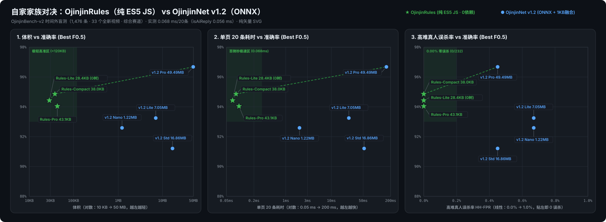
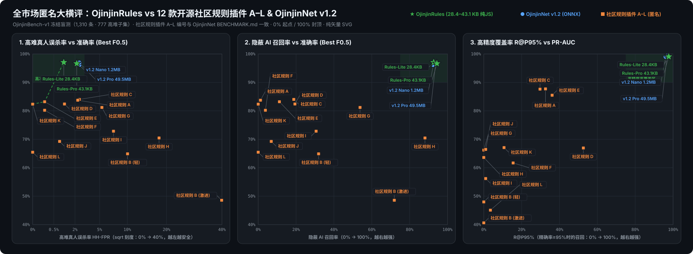

# OjinjinRules

由 [OjinjinNet](https://github.com/LiJiaHua1024/OjinjinNet) 旗舰教师模型蒸馏导出的 **纯 ES5 JavaScript 静态加权规则引擎**，用于 B 站评论区 AI / 养鱼评论识别。

- **零依赖 / 零 WASM / 零 ONNX / 零联网**：单文件纯 ES5 JS，无需打包器，不增加 `@require` 或 `@connect` 权限，可直接内联到油猴脚本、浏览器扩展或接口 JSON 拦截层。
- **同步微秒级推理（扁平字符串 + 零切片整数哈希 + 精确分支定界）**：单线程 V8 在 `Bench-v2` 全量 1,476 条真实评论上实测，默认 `ojinjin-rules-lite.js` 的 **`scoreReply` 为 3.39 µs/条（20 条 0.068 ms）**，直接布尔判定 **`isAiReply` 仅 2.82 µs/条（20 条 0.056 ms）**——比本机 PC 4 核 C++ ONNX `Nano v1.2`（`2.00 ms`）快 **29.5×–35.5×**，比浏览器单线程 WASM 快约 **200×–250×**，且无异步冷启动，评论进入 DOM 前即可同步判定。
- **规则表透明可审计**：默认档 `ojinjin-rules-lite.js`（**28.4 KB 明文 / 10.0 KB gzip**，**0 棵决策树**）仅由 **299 条 INT8 词片/边界 n-gram 权重 + 38 条文风算术特征 + 9 条评论 JSON 原生特征** 的线性加权求和组成，同时包含正向 AI 信号与负向真人豁免权重。

---

## 一、自家家族对决：`OjinjinRules` vs `OjinjinNet v1.2`（`OjinjinBench-v2` 盲测）

所有指标均在冻结盲测集 **`OjinjinBench-v2 Clean`（1,476 条 · 33 个全新视频 · 与训练集和标定集 0 `bvid` / 0 `rpid` 重叠）** 上，直接通过 Node.js V8 执行导出 JS 实测得到。



### 综合 / 评论原生赛道（输入 B 站 `/x/v2/reply` 原始评论对象，零 DOM）

| 方案 | 形态 / 体积 | 20 条耗时 | Best F0.5 | PR-AUC | R@P95% | 高难真人误杀率 (P95) |
|---|---|---:|---:|---:|---:|---:|
| **`ojinjin-rules-compact`** | **38.0 KB (13.5 KB gz)** | **0.081 ms** | **0.9486** | **0.9741** | 82.7% | **0.00%** (0/232) |
| **`ojinjin-rules-lite`（0 树）** | **28.4 KB (10.0 KB gz)** | **0.068 ms** (`isAiReply` **0.056 ms**) | **0.9443** | **0.9732** | 84.0% | **0.00%** (0/232) |
| **`ojinjin-rules-pro`** | **43.1 KB (15.8 KB gz)** | **0.094 ms** | 0.9404 | 0.9694 | **86.7%** | **0.00%** (0/232) |
| `OjinjinNet-Pro v1.2` + 1KB 融合 | 49.49 MB ONNX | 161.3 ms | **0.9668** | 0.9706 | 85.3% | 0.45% |
| `OjinjinNet-Lite v1.2` + 1KB 融合 | 7.05 MB ONNX | 24.2 ms | 0.9325 | 0.9595 | 82.7% | 0.67% |
| `OjinjinNet-Nano v1.2` + 1KB 融合 | 1.22 MB ONNX | 2.00 ms | 0.9259 | 0.9637 | 77.3% | 0.67% |
| `OjinjinNet-Std v1.2` + 1KB 融合 | 16.86 MB ONNX | 52.4 ms | 0.9121 | 0.9486 | 74.7% | 0.45% |

> **开箱固定阈值实测**（阈值仅在 `final_val` 上预先固定，未看盲测集）：
> - `ojinjin-rules-lite` 平衡档（`>= 0.65`）：`F0.5 = 0.9292` · 精确率 **95.5%** · 总召回 **84.0%** · 隐蔽 AI 召回 **82.5%** · 高难真人误杀 **0.00%**（`TP = 63, FP = 3`）
> - `ojinjin-rules-compact` 严格档（`>= 0.75`）：`F0.5 = 0.9322` · 精确率 **100.0%** · 总召回 **73.3%** · 隐蔽 AI 召回 **76.2%** · 高难真人误杀 **0.00%**（`TP = 55, FP = 0`）

### 纯文本赛道（仅输入评论正文，零昵称 / 零等级）

| 方案 | 体积 | Best F0.5 | PR-AUC | R@P95% | Hard 子集 F0.5 |
|---|---:|---:|---:|---:|---:|
| **`ojinjin-rules-pro` 纯文本** | **43.1 KB** | **0.9237** | 0.8880 | **78.7%** | **0.9569** |
| **`ojinjin-rules-compact` 纯文本** | **38.0 KB** | 0.8824 | 0.8627 | 63.9% | 0.9091 |
| **`ojinjin-rules-lite` 纯文本（0 树）** | **28.4 KB** | 0.8756 | 0.8664 | 65.6% | 0.9189 |
| `OjinjinNet-Pro v1.2` 纯文本 | 49.49 MB | 0.9072 | **0.9077** | 70.5% | 0.9259 |
| `OjinjinNet-Nano v1.2` 纯文本 | 1.22 MB | 0.8889 | 0.8818 | 65.6% | 0.9155 |

---

## 二、全市场匿名大横评：`OjinjinBench-v1`（1,310 条 · 12 款匿名化社区规则插件 A–L）

为保持技术评测客观中立、避免对个人开源作者点名，社区规则插件沿用 [OjinjinNet BENCHMARK.md](https://github.com/LiJiaHua1024/OjinjinNet/blob/main/docs/BENCHMARK.md) 的统一匿名编号 **`社区规则插件 A–L`** 呈现全部 12 款实测原值。



| 方案 | 形态 / 架构 | Full Best F0.5 | Full PR-AUC | R@P95% | Hard R@P95% | 隐蔽 AI 召回 | 高难真人误杀率 |
|---|---|---:|---:|---:|---:|---:|---:|
| **`ojinjin-rules-lite` 评论原生（0 树）** | **28.4 KB 纯 ES5 JS** | **0.9706** | **0.9929** | **97.7%** | **92.5%** | **92.7%** | **1.08%** |
| **`ojinjin-rules-compact` 评论原生** | **38.0 KB 纯 ES5 JS** | 0.9681 | 0.9898 | 97.1% | 86.2% | 93.8% | 1.81% |
| **`ojinjin-rules-pro` 评论原生** | **43.1 KB 纯 ES5 JS** | 0.9664 | 0.9907 | **97.7%** | 88.1% | **94.4%** | 2.17% |
| **`ojinjin-rules-lite` 纯文本（零元信息）** | **28.4 KB 纯 ES5 JS** | 0.9292 | 0.9559 | 81.0% | 75.0% | 76.9% | 2.53% |
| `OjinjinNet-Pro v1.2` + 1KB 融合 | 49.49 MB ONNX | 0.9695 | 0.9935 | 96.8% | 89.4% | 93.8% | 2.43% |
| `OjinjinNet-Nano v1.2` + 1KB 融合 | 1.22 MB ONNX | 0.9615 | 0.9900 | 96.1% | — | 92.5% | 2.43% |
| 社区规则插件 C（三层加权评分扩展） | 人工规则 | 0.8403 | 0.8764 | 29.7% | 0.0% | 18.8% | 2.43% |
| 社区规则插件 A（高星多规则评分扩展） | 人工规则 | 0.8375 | 0.8772 | 32.6% | 0.0% | 1.2% | 2.27% |
| 社区规则插件 E（话术模式分值折叠） | 人工规则 | 0.8321 | 0.8550 | 36.1% | 0.0% | 11.2% | 0.16% |
| 社区规则插件 D（3,100 评论实证调参） | 人工规则 | 0.8241 | 0.6695 | 52.6% | 2.5% | 19.4% | 1.13% |
| 社区规则插件 K（强证据自述优先脚本） | 人工规则 | 0.8236 | 0.6709 | 10.7% | 0.0% | 0.0% | 0.00% |
| 社区规则插件 G（四特征联合过滤脚本） | 人工规则 | 0.8120 | 0.6620 | 0.0% | 0.0% | 53.8% | 5.35% |
| 社区规则插件 F（多来源独立证据规则） | 人工规则 | 0.8021 | 0.6168 | 15.5% | 0.0% | 3.8% | 0.16% |
| 社区规则插件 I（多维 + 伪口语规则） | 人工规则 | 0.7285 | 0.5620 | 1.0% | 0.0% | 30.6% | 7.29% |
| 社区规则插件 H（低等级 + 关键词直拦） | 人工规则 | 0.7046 | 0.6361 | 0.0% | 0.0% | 88.1% | 17.83% |
| 社区规则插件 J（`@` 门控多维评分） | 人工规则 | 0.6926 | 0.6646 | 1.0% | 1.2% | 6.9% | 0.81% |
| 社区规则插件 L（人设 + 自我声明保守规则） | 人工规则 | 0.6546 | 0.4509 | 3.5% | 0.0% | 0.0% | 0.00% |
| 社区规则插件 B（三档正则 · 轻 / 标 / 激进） | 纯正则 | 0.6489 / 0.4289 / 0.4857 | 0.4798 / 0.3333 / 0.4063 | 0.0% | 0.0% | 31.9% / 35.6% / 71.9% | 10.05% / 32.90% / 39.87% |

> 注：ONNX 模型耗时为本机 PC 4 线程 ONNX Runtime 20 条分桶 p50（浏览器单线程 WASM 下 Nano 约 12–16 ms，且首次需加载约 15 MB WASM 运行时）；`OjinjinRules` 耗时为单线程 V8 实测，无 WASM 冷启动。社区规则插件 A–L 的「隐蔽 AI 召回 / 高难真人误杀率」为默认出厂档离线实测。

---

## 版本选型

| 文件 | 体积 | 内部结构 | 适用场景 |
|---|---:|---|---|
| [`dist/ojinjin-rules-lite.js`](dist/ojinjin-rules-lite.js) | **28.4 KB** (`10.0 KB` gz) | **0 树纯线性**：299 INT8 词片 + 38 文风 + 9 评论元信息（`0.068 ms / 20 条`，`isAiReply` `0.056 ms`） | **推荐默认**。最轻最快、全明文线性规则，可直接嵌入纯规则油猴脚本 / 扩展 |
| [`dist/ojinjin-rules-compact.js`](dist/ojinjin-rules-compact.js) | **38.0 KB** (`13.5 KB` gz) | 300 INT8 词片 + 38 文风 + 9 元信息 + 65 棵深度 3 扁平 TypedArray 浅树（`0.081 ms / 20 条`） | 偏严格低误杀档位，`Bench-v2` 综合 F0.5 最高（`0.9486`） |
| [`dist/ojinjin-rules-pro.js`](dist/ojinjin-rules-pro.js) | **43.1 KB** (`15.8 KB` gz) | 800 INT8 词片 + 38 文风 + 9 元信息 + 65 棵深度 3 扁平 TypedArray 浅树（`0.094 ms / 20 条`） | **纯文本场景最强**（无用户等级/昵称时 `Bench-v2 F0.5 = 0.9237`） |

---

## 快速接入

### 浏览器 / 油猴脚本（直接内联或引入）

直接传入 B 站 `/x/v2/reply` 接口返回的原始 `reply` 对象即可，也可仅传入纯文本：

```js
// 1. 直接对 B 站评论 API 对象打分（自动读取 content.message / member.uname / level_info.current_level / parent）
var prob = OjinjinRules.scoreReply(reply);
var blocked = OjinjinRules.isAiReply(reply, 'balanced'); // 'strict' | 'balanced' | 'aggressive'

// 2. 仅使用纯文本打分（无元信息）
var textProb = OjinjinRules.scoreText('这条视频的节奏确实很稳——值得细看。');
var textBlocked = OjinjinRules.isAiText(message, 'balanced');
```

### Node.js

```js
const OjinjinRules = require('./dist/ojinjin-rules-lite.js');

const prob = OjinjinRules.scoreReply({
  parent: 0,
  member: { uname: '路人账号', level_info: { current_level: 2 } },
  content: { message: '这条视频确实把核心问题讲透了——从前期铺垫到最后收束都很顺。' }
});
console.log(prob);
```

本地验证：

```bash
npm test
```

---

## 工作原理与边界说明

### 为什么 28.4 KB 明文（10 KB gzip）的静态规则表能大幅超越人工手写规则

1. **大模型软概率蒸馏**：规则权重由 `OjinjinNet-Pro v1.2`（4 教师 Super-Teacher）在 26,928 条真实与无标注评论上产出的连续软概率蒸馏而来，而非人工拍脑袋或小样本硬标签拟合。
2. **正负双向权重**：筛选特征时强制保留高权重的负向「真人豁免」词片（如 `但是`、`。。`、`比较`、`可以`、`感觉`、`现在`、B 站表情占位符等），与正向 AI 信号对冲，大幅压低认真科普/影评长评的误杀率。
3. **表面文风 + 长度归一化**：显式保留句号结尾、句长变异系数、全角标点密度等中文短评强特征，并用 `sqrt(50 / (cleanLen + 20))` 归一化词片累加和，防止长评论因命中过多词片出现极端高分误报。
4. **解耦元信息拟合**：文本权重在全量蒸馏语料上学习；评论元信息权重（昵称规则、`@主人` 关联、用户等级、楼中楼标志）仅在真实非合成评论上独立拟合，避免合成样本引入假相关性。

### 局限性与互补方案

- **对抗鲁棒性边界**：规则表以明文静态权重形式存在于 JS 中。如果养鱼脚本针对词表系统性改写提示词（规避标点与高频短语）并配合高等级账号，静态规则的召回率会比深度语义模型下降更快。
- **与 `OjinjinNet` 的关系**：本仓库是 `OjinjinNet` 蒸馏管线的 **Tier 0 零依赖轻量产物**。当需要更强的纯文本语义理解或抗对抗能力时，请配合上游神经网络模型仓库 [OjinjinNet](https://github.com/LiJiaHua1024/OjinjinNet)（`Nano 1.22 MB` / `Pro 49.5 MB`）使用；当生态话术演进时，上游会通过主动学习重新蒸馏更新规则表。

---

## License

[Apache-2.0](LICENSE)
