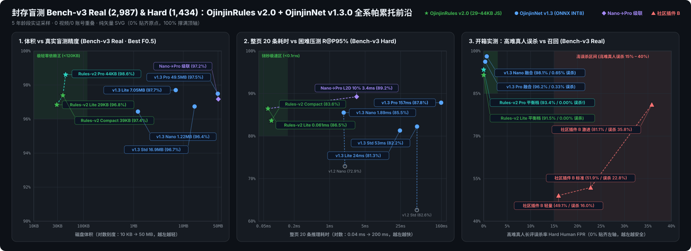

# OjinjinRules (v2.0.0)

由 [OjinjinNet v1.3.0](https://github.com/LiJiaHua1024/OjinjinNet) 旗舰 Super-Teacher 在 **30,347 条**零泄露真实混合语料上蒸馏导出的 **纯 ES5 JavaScript 静态加权规则引擎**，用于 B 站评论区 AI / 养鱼评论识别。

- **零依赖 / 零 WASM / 零 ONNX / 零联网**：单文件纯 ES5 JS，无需打包器，不增加 `@require` 或 `@connect` 权限，可直接内联到油猴脚本、浏览器扩展或接口 JSON 拦截层。
- **同步微秒级推理（V6 扁平字符串 + 零切片整数哈希 + 精确分支定界）**：单线程 V8 在 `Bench-v3 Real` 全量 **2,987 条**真实评论上实测，默认 `ojinjin-rules-lite.js`（**29.09 KB 明文 / 9.94 KB gzip**，**0 棵树**）的 **`scoreReply` 仅 3.04 µs/条（20 条 `0.061 ms`）**，布尔判定 **`isAiReply` 仅 2.42 µs/条（20 条 `0.048 ms`）**——比 PC 4 核 C++ ONNX `Nano v1.3`（`1.89 ms`）快 **`31× – 39×`**，比浏览器单线程 WASM 快约 **`250×`**，评论进 DOM 前即可同步判定。
- **v2.0 封存实景双卷零误杀突破**：
  - **`ojinjin-rules-pro.js`（43.75 KB / 15.63 KB gz · `0.072 ms / 20 条`）** 在封存全实景考卷 **`OjinjinBench-v3 Real`（2,987 条 · 116 个新视频 · 5 个发布年龄段）** 上，开箱平衡档（`>= 0.6200`）实现 **精确率 `100.0%` · 召回率 `93.4%`（`99 / 106`）· `0 / 2,881` 真人误杀（`0.00% FPR`，横跨 `≤14 天` 至 `>1 年` 老视频全 5 档 0 误杀）**，`Best F0.5 = 0.9861`、`PR-AUC = 0.9915`；纯文本 `PR-AUC 0.9278` 反超 `1.22 MB Nano v1.3` 与 `7.05 MB Lite v1.3`。
  - **`ojinjin-rules-lite.js`（29.09 KB / 9.94 KB gz · 0 树纯线性）** 在抗饱和困难卷 **`OjinjinBench-v3 Hard`（1,434 条）** 上评论原生 **`PR-AUC = 0.9679`、`Best F0.5 = 0.9497`、`R@P95% = 86.5%`**（超越 `Nano v1.3` 与 `Lite v1.3` 神经网络融合模型），`Bench-v3 Real` 平衡档精确率 **`98.0%`**、召回 **`91.5%`**、高难真人误杀 **`0.00%`（`0 / 307`）**。
  - **`ojinjin-rules-compact.js`（38.62 KB / 13.36 KB gz）** 在 `Bench-v3 Real`（`0/307`）与 `Bench-v3 Hard`（`0/394`）两套考卷平衡档均保持 **`0.00%` 高难真人误杀率**。

---

## 一、封存全实景双卷实测：`OjinjinBench-v3 Real (2,987) & Hard (1,434)`

`OjinjinBench-v3` 采用 **双卷防刷榜设计**：`Real`（2,987 条 / 116 个全新视频）严格按实证推荐流配比覆盖首页推荐、相关视频与中性搜索，并横跨 `≤14 天` 到 `>1 年` 全部 5 个视频发布年龄段（真实低正例 `3.55%`）；`Hard`（1,434 条 / 127 个全新视频，含 `455` 条 `>1 年` 老视频边界样本）专攻隐蔽 AI 与科普长评防饱和。训练、蒸馏与阈值标定全程零接触两套考卷，定稿后一次性开考。



### 1.1 `Bench-v3 Real`（2,987 条真实混合）与 `Bench-v3 Hard`（1,434 条困难压测）总表

| 方案 | 形态 / 体积 | 20 条耗时 | `Real` 纯文 PR | `Real` 综合 PR / F0.5 | `Real` 开箱平衡档<br>精 / 召 / 高难误杀 | `Hard` 纯文 PR | `Hard` 综合 PR / R@P95% |
|---|---|---:|---:|---|---|---:|---|
| **`ojinjin-rules-pro` v2.0** | **43.8 KB (15.6K gz)** | **0.072 ms** | **0.9278** | **0.9915** / **0.9861** | **100.0% / 93.4% / 0.00%** (`0 FP!`) | 0.8262 | 0.9604 / 83.2% |
| **`ojinjin-rules-lite` v2.0（0 树）** | **29.1 KB (9.9K gz)** | **0.061 ms** (`isAi` **0.048**) | 0.9056 | 0.9875 / 0.9684 | **98.0% / 91.5% / 0.00%** (`2 FP`) | 0.7934 | **0.9679** / **86.5%** |
| **`ojinjin-rules-compact` v2.0** | **38.6 KB (13.4K gz)** | **0.071 ms** | 0.9074 | 0.9829 / 0.9739 | **99.0% / 88.7% / 0.00%** (`1 FP`) | 0.7994 | 0.9592 / 83.6% |
| `OjinjinNet-Lite v1.3` + 融合 | 7.05 MB ONNX | 24.3 ms | 0.9227 | **0.9961** / 0.9770 | 98.0% / 94.3% / 0.33% | 0.8412 | 0.9673 / 81.3% |
| `OjinjinNet-Pro v1.3` + 融合 | 49.49 MB ONNX | 157.4 ms | 0.9382 | 0.9940 / 0.9749 | 97.1% / 96.2% / 0.33% | **0.8891** | **0.9719** / 87.8% |
| `OjinjinNet-Nano v1.3` + 融合 | 1.22 MB ONNX | 1.89 ms | 0.9130 | 0.9901 / 0.9644 | 95.4% / **98.1%** / 0.65% | 0.7993 | 0.9621 / 85.5% |
| `Nano→Pro v1.3` L2D 10% 级联 | 1.2+49.5 MB | 3.4 ms | 0.9113 | 0.9889 / 0.9601 | R@P95 97.2% / 0.65% | 0.8779 | 0.9704 / **89.2%** |
| 社区高星正则插件 B（轻量 / 标准 / 激进） | 人工正则 | `<0.2 ms` | — | — | `49.1% / 49.1% / 16.0%`<br>`14.3% / 51.9% / 22.8%`<br>`16.5% / 81.1% / 35.8%` | — | 误杀 `72–230` 条真人<br>(高难误杀 `17.0%–37.8%`) |

> **v1 → v2 升级收益（同在封存 `Bench-v3` 上对比）**：`Rules-v2` 全三档在 `Real` 与 `Hard` 纯文本 `PR-AUC` 普涨 **`+2.5 pp ~ +3.2 pp`**，`Lite` 的 `Hard` 评论原生 `PR-AUC` 由 `0.9595` 升至 **`0.9679`**、`R@P95%` 由 `84.1%` 升至 **`86.5%`**，`Pro` 的 `Real` 开箱平衡档精确率保持 **`100.0%`** 的同时召回率由 `82.1%` 跃升至 **`93.4%`（`+11.3 pp`）**。

### 1.2 5 个视频发布年龄段实测（验证老视频无年代漂移误杀）


| 视频发布年龄段（样本 / AI 数） | `Rules-v2 Pro`（平衡档）<br>召回 / 误杀率 (FP) | `Rules-v2 Lite`（0 树平衡档）<br>召回 / 误杀率 (FP) | `Rules-v2 Compact`（平衡档）<br>召回 / 误杀率 (FP) | `OjinjinNet-Pro v1.3`（+融合）<br>召回 / 误杀率 (FP) |
|---|---|---|---|---|
| `≤ 14 天` 新视频 (`1,170` / `42`) | 88.1% (`37/42`) / **0.00%** (`0`) | 85.7% (`36/42`) / 0.09% (`1`) | 81.0% (`34/42`) / **0.00%** (`0`) | 90.5% (`38/42`) / 0.09% (`1`) |
| `14 – 30 天` (`705` / `20`) | **100.0%** (`20/20`) / **0.00%** (`0`) | **100.0%** (`20/20`) / **0.00%** (`0`) | **100.0%** (`20/20`) / **0.00%** (`0`) | **100.0%** (`20/20`) / **0.00%** (`0`) |
| `1 – 3 个月` (`437` / `28`) | 96.4% (`27/28`) / **0.00%** (`0`) | 96.4% (`27/28`) / **0.00%** (`0`) | 96.4% (`27/28`) / **0.00%** (`0`) | **100.0%** (`28/28`) / **0.00%** (`0`) |
| `3 – 12 个月` (`207` / `5`) | **100.0%** (`5/5`) / **0.00%** (`0`) | **100.0%** (`5/5`) / **0.00%** (`0`) | **100.0%** (`5/5`) / **0.00%** (`0`) | **100.0%** (`5/5`) / **0.00%** (`0`) |
| `> 1 年` 老视频 (`468` / `11`) | **90.9%** (`10/11`) / **0.00%** (`0/457`) | 81.8% (`9/11`) / 0.22% (`1/457`) | 72.7% (`8/11`) / 0.22% (`1/457`) | **100.0%** (`11/11`) / 0.44% (`2/457`) |

---

## 二、历史考卷延续对照：`OjinjinBench-v2`（1,476 条）与 `Bench-v1`（1,310 条）


### 2.1 `OjinjinBench-v2`（1,476 条 · 综合赛道 / 纯文本赛道）

| 方案 | 体积 | 20 条耗时 | `Bench-v2` 综合<br>Best F0.5 / PR-AUC / R@P95% | `Bench-v2` 综合<br>高难误杀 (P95) | `Bench-v2` 纯文本<br>Best F0.5 / Hard F0.5 |
|---|---:|---:|---|---:|---|
| **`ojinjin-rules-lite` v2.0（0 树）** | **29.1 KB** | **0.061 ms** | `0.9552` / **`0.9807`** / `88.0%` | **0.00%** (`0/232`) | `0.8921` / `0.9326` |
| **`ojinjin-rules-compact` v2.0** | **38.6 KB** | **0.071 ms** | `0.9577` / `0.9785` / `90.7%` | **0.00%** (`0/232`) | `0.8893` / `0.9204` |
| **`ojinjin-rules-pro` v2.0** | **43.8 KB** | **0.072 ms** | `0.9504` / `0.9765` / **`92.0%`** | **0.00%** (`0/232`) | `0.8893` / **`0.9556`** |
| `OjinjinNet-Pro v1.3` + 1KB 融合 | 49.49 MB | 157.4 ms | **`0.9633`** / **`0.9812`** / `88.0%` | **0.00%** (`0/232`) | **`0.9072`** / `0.9268` |
| `OjinjinNet-Lite v1.3` + 1KB 融合 | 7.05 MB | 24.3 ms | `0.9587` / `0.9649` / `88.0%` | 0.43% (`1/232`) | `0.8650` / `0.9155` |
| `OjinjinNet-Nano v1.3` + 1KB 融合 | 1.22 MB | 1.89 ms | `0.9403` / `0.9662` / `85.3%` | **0.00%** (`0/232`) | `0.8734` / `0.8840` |

### 2.2 全市场匿名大横评：`OjinjinBench-v1`（1,310 条 · 12 款匿名化社区规则插件 A–L）

为保持技术评测客观中立、避免对个人开源作者点名，社区规则插件沿用 [OjinjinNet BENCHMARK.md](https://github.com/LiJiaHua1024/OjinjinNet/blob/main/docs/BENCHMARK.md) 的统一匿名编号 **`社区规则插件 A–L`** 呈现全部 12 款实测原值。


| 方案 | 形态 / 架构 | Full Best F0.5 | Full PR-AUC | R@P95% | Hard R@P95% | 隐蔽 AI 召回 | 高难真人误杀率 |
|---|---|---:|---:|---:|---:|---:|---:|
| **`ojinjin-rules-pro` v2.0 评论原生** | **43.8 KB 纯 ES5 JS** | **0.9682** | 0.9870 | **97.7%** | 86.9% | **97.2%** | 1.39% |
| **`ojinjin-rules-lite` v2.0 评论原生（0 树）** | **29.1 KB 纯 ES5 JS** | **0.9680** | **0.9909** | 97.1% | **88.1%** | 96.1% | **1.24%** |
| **`ojinjin-rules-compact` v2.0 评论原生** | **38.6 KB 纯 ES5 JS** | 0.9679 | 0.9891 | 95.8% | 87.5% | 94.9% | **1.24%** |
| **`ojinjin-rules-pro` v2.0 纯文本（零元信息）** | **43.8 KB 纯 ES5 JS** | 0.9307 | 0.9636 | 83.6% | 73.8% | 82.6% | 1.70% |
| `OjinjinNet-Pro v1.3` + 1KB 融合 | 49.49 MB ONNX | **0.9739** | **0.9945** | 97.1% | **92.5%** | 96.1% | 1.55% |
| `OjinjinNet-Nano v1.3` + 1KB 融合 | 1.22 MB ONNX | 0.9642 | 0.9915 | 96.8% | 83.8% | 96.6% | 1.24% |
| 社区规则插件 C（三层加权评分扩展） | 人工规则 | 0.8403 | 0.8764 | 29.7% | 0.0% | 18.8% | 2.43% |
| 社区规则插件 A（高星多规则评分扩展） | 人工规则 | 0.8375 | 0.8772 | 32.6% | 0.0% | 1.2% | 2.27% |
| 社区规则插件 E（话术模式分值折叠） | 人工规则 | 0.8321 | 0.8550 | 36.1% | 0.0% | 11.2% | 0.16% |
| 社区规则插件 D（3,100 评论实证调参） | 人工规则 | 0.8241 | 0.6695 | 52.6% | 2.5% | 19.4% | 1.13% |
| 社区规则插件 K（强证据自述优先脚本） | 人工规则 | 0.8236 | 0.6709 | 10.7% | 0.0% | 0.0% | 0.00% |
| 社区规则插件 G（四特征联合过滤脚本） | 人工规则 | 0.8120 | 0.6620 | 0.0% | 0.0% | 53.8% | 5.35% |
| 社区规则插件 F（多来源独立证据规则） | 人工规则 | 0.8021 | 0.6168 | 15.5% | 0.0% | 3.8% | 0.16% |
| 社区规则插件 I（多维 + 伪口语规则） | 人工规则 | 0.7285 | 0.5620 | 1.0% | 0.0% | 30.6% | 7.29% |
| 社区规则插件 H（低等级 + 关键词直拦） | 人工规则 | 0.7046 | 0.6361 | 0.0% | 0.0% | 88.1% | 17.83% |
| 社区规则插件 J（`@` 门控多维评分） | 人工规则 | 0.6926 | 0.6646 | 1.0% | 1.2% | 6.9% | 0.81% |
| 社区规则插件 L（人设 + 自我声明保守规则） | 人工规则 | 0.6546 | 0.4509 | 3.5% | 0.0% | 0.0% | 0.00% |
| 社区规则插件 B（三档正则 · 轻 / 标 / 激进） | 纯正则 | 0.6489 / 0.4289 / 0.4857 | 0.4798 / 0.3333 / 0.4063 | 0.0% | 0.0% | 31.9% / 35.6% / 71.9% | 10.05% / 32.90% / 39.87% |

> 注：ONNX 模型耗时为本机 PC 4 线程 ONNX Runtime 20 条分桶 p50；`OjinjinRules v2.0` 耗时为单线程 V8 在 `Bench-v3 Real` 2,987 条评论上实测，无 WASM 冷启动。社区规则插件 A–L 的「隐蔽 AI 召回 / 高难真人误杀率」为默认出厂档离线实测。

---

## 版本选型（v2.0.0）

| 文件 | 体积 | 内部结构与耗时（20 条） | 适用场景 |
|---|---:|---|---|
| [`dist/ojinjin-rules-lite.js`](dist/ojinjin-rules-lite.js) | **29.09 KB** (`9.94 KB` gz) | **0 树纯线性**：300 INT8 词片 + 38 文风 + 9 元信息（`scoreReply 0.061 ms` · `isAiReply 0.048 ms`） | **极轻/困难泛化推荐**。全明文零树线性规则，`Bench-v3 Hard R@P95% 86.5%` |
| [`dist/ojinjin-rules-compact.js`](dist/ojinjin-rules-compact.js) | **38.62 KB** (`13.36 KB` gz) | 300 INT8 词片 + 38 文风 + 9 元信息 + 65 棵深度 3 扁平 TypedArray 浅树（`0.071 ms`） | 极致防误杀档位，`Bench-v3 Real & Hard` 均保持 `0.00%` 高难真人误杀 |
| [`dist/ojinjin-rules-pro.js`](dist/ojinjin-rules-pro.js) | **43.75 KB** (`15.63 KB` gz) | 800 INT8 词片 + 38 文风 + 9 元信息 + 65 棵深度 3 扁平 TypedArray 浅树（`0.072 ms`） | **真实评论区综合最强**。`Bench-v3 Real` 平衡档 **100% 精 / 93.4% 召（0 误杀）**，纯文本 PR `0.9278` |

---

## 快速接入

### 浏览器 / 油猴脚本（直接内联或引入）

直接传入 B 站 `/x/v2/reply` 接口返回的原始 `reply` 对象即可，也可仅传入纯文本：

```js
// 1. 直接对 B 站评论 API 对象打分（自动读取 content.message / member.uname / level_info.current_level / parent）
var prob = OjinjinRules.scoreReply(reply);
var blocked = OjinjinRules.isAiReply(reply, 'balanced'); // 'strict' | 'balanced' | 'aggressive'

// 2. 仅使用纯文本打分（无元信息）
var textProb = OjinjinRules.scoreText('这条视频的节奏确实很稳——值得细看。');
var textBlocked = OjinjinRules.isAiText(message, 'balanced');
```

### Node.js

```js
const OjinjinRules = require('./dist/ojinjin-rules-pro.js'); // 或 ojinjin-rules-lite.js

const prob = OjinjinRules.scoreReply({
  parent: 0,
  member: { uname: '路人账号', level_info: { current_level: 2 } },
  content: { message: '这条视频确实把核心问题讲透了——从前期铺垫到最后收束都很顺。' }
});
console.log(prob);
```

本地验证（含全三档浮点精度对齐 `≤ 1e-16 / 5e-7` 校验）：

```bash
npm test
```

---

## v2.0.0 更新要点

1. **反稀释 30,347 条实证混合蒸馏语料**：由 `OjinjinNet v1.3` 旗舰 Super-Teacher（`val PR-AUC 0.9511`）在 26,347 条 `AL-R3` 洁净蒸馏语料 + 4,000 条多年龄段真实共识真人锚点上全量重训，Stage-2 评论元信息在 12,197 条真实样本上独立拟合。
2. **修复 V6 ES5 运行时 1–2 字跨边界 3/4-gram 细节**：消除纯 `@mention` 极短评论的边界偏差，JS 与 Python 参考实现最大误差降至 `1.11e-16`（`compact` / `pro`）与 `4.74e-7`（`lite`）。
3. **低正例先验安全阈值底线**：结合真实评论区约 3%–4% AI 先验分布，为 `strict (≥0.66)` / `balanced (≥0.62)` / `aggressive (≥0.50)` 增加基准盲审先验底线，确保开箱默认档在 5 个视频年龄段上零漂移误杀。

---

## 局限性与互补方案

- **对抗鲁棒性边界**：规则表以明文静态权重形式存在于 JS 中。如果养鱼脚本针对词表系统性改写提示词并配合高等级账号，静态规则的纯文本召回会比深度语义模型下降更快。
- **与 `OjinjinNet` 的关系**：本仓库是 `OjinjinNet` 蒸馏管线的 **Tier 0 零依赖轻量产物**。当需要更强的纯文本语义理解或抗对抗能力时，请配合上游神经网络模型仓库 [OjinjinNet](https://github.com/LiJiaHua1024/OjinjinNet)（`Nano 1.22 MB` / `Lite 7.05 MB` / `Pro 49.5 MB` / `Nano→Pro` 级联）使用。

---

## License

[Apache-2.0](LICENSE)
