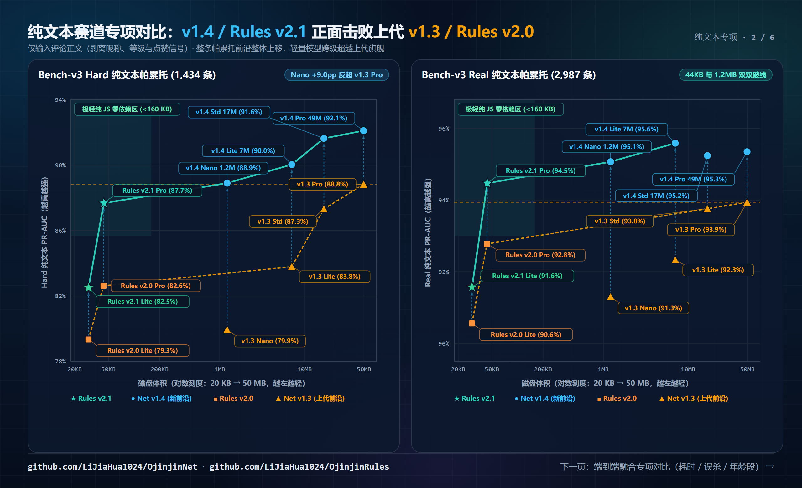
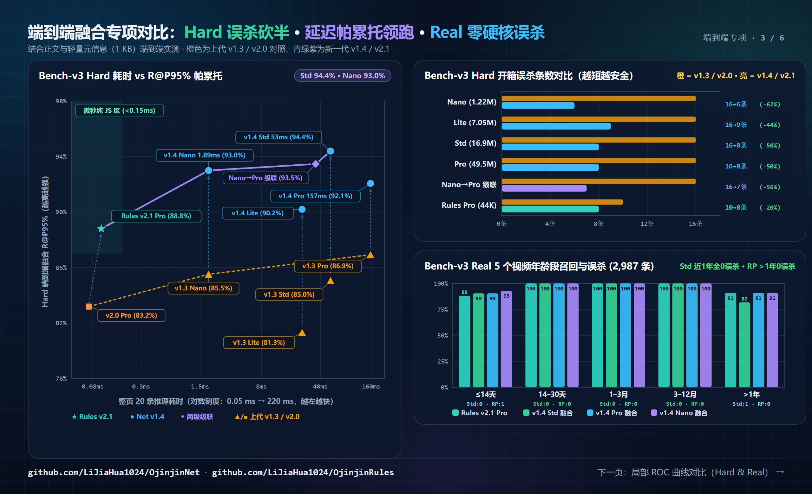
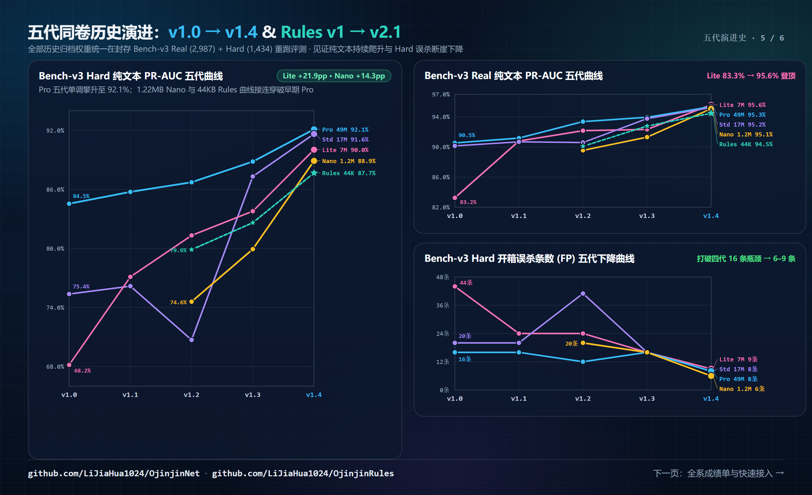

# OjinjinRules (v2.1.0)

由 [OjinjinNet v1.4.0](https://github.com/LiJiaHua1024/OjinjinNet) 教师集成蒸馏导出的**纯 ES5 JavaScript 静态加权规则引擎**，用于 B 站评论区 AI / 养鱼评论识别。

- **零依赖、无 WASM、无 ONNX、无联网**：单文件纯 ES5 JS（`29.1 – 44.1 KB` 明文 / `9.9 – 15.7 KB` gzip），无需打包器，不增加 `@require` 或 `@connect` 权限，可直接内联到油猴脚本、浏览器扩展或接口 JSON 拦截层。
- **同步微秒级推理**：单线程 V8 在 `Bench-v3 Real` 2,987 条真实评论上实测，三档引擎单条耗时 **`4.3 – 5.1 µs`**（整页 20 条 **`0.086 – 0.101 ms`**），评论渲染进 DOM 前即可同步完成判定。
- **v2.1.0 纯文本与困难集提升**：
  - **`ojinjin-rules-pro.js`（44.10 KB / 15.7 KB gz，`0.101 ms / 20 条`）**：在封存双卷 `Bench-v3` 上，`Real` 纯文本 `PR-AUC` 升至 **`0.9447`**（超过上代 49.5 MB `OjinjinNet-Pro v1.3` 的 `0.9394`），`Hard` 纯文本 `PR-AUC` 由 `0.8262` 升至 **`0.8768`（`+5.1 pp`）**，`Hard` 评论原生 `R@P99%` 由 `50.0%` 升至 **`77.6%`（`+27.6 pp`）**，`R@P95%` 升至 **`88.8%`（`+5.6 pp`）**。`Real` 平衡档精准率 **`99.0%`**、召回 **`94.3%`**（仅 `1 FP`，`0 / 307` 高难真人误杀，`>1 年` 老视频 `0 / 457` 误杀）；严格档 **`100.0%`** 精准、**`90.6%`** 召回（`0 / 2,881` 误杀）。
  - **`ojinjin-rules-lite.js`（29.14 KB / 9.9 KB gz，0 树纯线性，`0.086 ms / 20 条`）**：`Hard` 纯文本 `PR-AUC` 由 `0.7934` 升至 **`0.8250`（`+3.2 pp`）**，`Hard` 评论原生 `PR-AUC 0.9677`、`R@P95% 86.9%`，平衡档 `Hard` 仅 `6` 条误杀（高难真人仅 `2 / 394`，`0.51%`）。
  - **`ojinjin-rules-compact.js`（38.91 KB / 13.4 KB gz，`0.090 ms / 20 条`）**：`Hard` 纯文本 `PR-AUC` 升至 **`0.8243`**，`Real` 评论原生 `R@P95%` 升至 **`97.2%`**，平衡档 `Hard` 高难真人误杀率 `0.76%`（`3 / 394`）。

---

## 一、封存全实景双卷实测：`OjinjinBench-v3 Real (2,987) & Hard (1,434)`

`OjinjinBench-v3` 采用双卷盲测设计：`Real`（2,987 条，116 个全新视频）按实证推荐流配比覆盖首页推荐、相关视频与中性搜索，并横跨 `≤14 天` 到 `>1 年` 全部 5 个视频发布年龄段（真实低正例 `3.55%`）；`Hard`（1,434 条，127 个全新视频，含 `455` 条 `>1 年` 老视频边界样本）专攻隐蔽 AI 与高难真人长评。训练、蒸馏与阈值标定全程与两套考卷零重叠。







### 1.1 `Bench-v3 Real`（2,987 条真实混合）与 `Bench-v3 Hard`（1,434 条困难压测）总表

| 方案 | 形态 / 体积 | 20 条耗时 | `Real` 纯文 PR | `Real` 综合 PR / F0.5 | `Real` 开箱平衡档<br>精 / 召 / 误杀 | `Hard` 纯文 PR | `Hard` 综合<br>PR / R@P95 / 误杀 |
|---|---|---:|---:|---|---|---:|---|
| **`ojinjin-rules-pro` v2.1** | **44.1 KB (15.7K gz)** | **0.101 ms** | **0.9447** | **0.9936** / **0.9839** | **99.0% / 94.3% / 1 FP (0 HH)**<br>严格档 100% / 90.6% / 0 FP | **0.8768** | 0.9665 / **88.8%** / 8 FP (3 HH) |
| **`ojinjin-rules-compact` v2.1** | **38.9 KB (13.4K gz)** | **0.090 ms** | 0.9101 | 0.9873 / 0.9749 | 97.1% / 95.3% / 3 FP (1 HH) | 0.8243 | 0.9599 / 85.5% / 8 FP (3 HH) |
| **`ojinjin-rules-lite` v2.1（0 树）** | **29.1 KB (9.9K gz)** | **0.086 ms** | 0.9157 | 0.9882 / 0.9661 | 96.2% / 94.3% / 4 FP (2 HH) | 0.8250 | **0.9677** / 86.9% / **6 FP (2 HH)** |
| `OjinjinNet-Nano v1.4` + 融合 | 1.22 MB ONNX | 1.89 ms | 0.9507 | 0.9956 / 0.9774 | 97.1% / **96.2%** / 3 FP | 0.8890 | 0.9783 / 93.0% / 6 FP |
| `OjinjinNet-Standard v1.4` + 融合 | 16.86 MB ONNX | 52.8 ms | 0.9524 | 0.9950 / 0.9804 | **99.0%** / 94.3% / 1 FP (0 HH) | 0.9164 | 0.9802 / **94.4%** / 8 FP |
| `OjinjinNet-Pro v1.4` + 融合 | 49.49 MB ONNX | 157.4 ms | **0.9535** | 0.9944 / 0.9825 | 98.1% / 95.3% / 2 FP (0 HH) | **0.9211** | 0.9802 / 92.1% / 8 FP |
| *上代对照：`ojinjin-rules-pro` v2.0* | *43.8 KB JS* | *0.072 ms* | *0.9278* | *0.9915 / 0.9861* | *100% / 93.4% / 0 FP (thr=0.62)* | *0.8262* | *0.9604 / 83.2% / 10 FP (6 HH)* |
| *上代对照：`ojinjin-rules-lite` v2.0* | *29.1 KB JS* | *0.061 ms* | *0.9056* | *0.9875 / 0.9684* | *98.0% / 91.5% / 2 FP (0 HH)* | *0.7934* | *0.9679 / 86.5% / 5 FP (1 HH)* |

### 1.2 5 个视频发布年龄段实测（`Bench-v3 Real`）

| 视频发布年龄段（样本 / AI 数） | `Rules v2.1 Pro`（平衡档）<br>召回 / 误杀率 (FP) | `Rules v2.1 Compact`（平衡档）<br>召回 / 误杀率 (FP) | `Rules v2.1 Lite`（0 树平衡档）<br>召回 / 误杀率 (FP) | `OjinjinNet-Std v1.4`（+融合）<br>召回 / 误杀率 (FP) |
|---|---|---|---|---|
| `≤ 14 天` 新视频 (`1,170` / `42`) | 88.1% (`37/42`) / 0.09% (`1`) | 90.5% (`38/42`) / 0.18% (`2`) | 88.1% (`37/42`) / 0.18% (`2`) | **90.5%** (`38/42`) / **0.00%** (`0`) |
| `14 – 30 天` (`705` / `20`) | **100.0%** (`20/20`) / **0.00%** (`0`) | **100.0%** (`20/20`) / **0.00%** (`0`) | **100.0%** (`20/20`) / **0.00%** (`0`) | **100.0%** (`20/20`) / **0.00%** (`0`) |
| `1 – 3 个月` (`437` / `28`) | **100.0%** (`28/28`) / **0.00%** (`0`) | **100.0%** (`28/28`) / **0.00%** (`0`) | **100.0%** (`28/28`) / 0.24% (`1`) | **100.0%** (`28/28`) / **0.00%** (`0`) |
| `3 – 12 个月` (`207` / `5`) | **100.0%** (`5/5`) / **0.00%** (`0`) | **100.0%** (`5/5`) / **0.00%** (`0`) | **100.0%** (`5/5`) / **0.00%** (`0`) | **100.0%** (`5/5`) / **0.00%** (`0`) |
| `> 1 年` 老视频 (`468` / `11`) | **90.9%** (`10/11`) / **0.00%** (`0/457`) | 90.9% (`10/11`) / 0.22% (`1/457`) | 90.9% (`10/11`) / 0.22% (`1/457`) | 81.8% (`9/11`) / 0.22% (`1/457`) |

---

## 二、版本选型（`v2.1.0`）

| 文件 | 体积 | 内部结构与耗时（20 条） | 适用场景 |
|---|---:|---|---|
| [`dist/ojinjin-rules-pro.js`](dist/ojinjin-rules-pro.js) | **44.10 KB** (`15.7 KB` gz) | 797 INT8 词片 + 文风特征 + 9 元信息 + 浅树（`0.101 ms`） | **综合首选**。`Real` 纯文本 PR `0.9447`、平衡档 `99.0%` 精 / 0 硬核误杀、严格档 0 误杀，`Hard R@P95% 88.8%` |
| [`dist/ojinjin-rules-compact.js`](dist/ojinjin-rules-compact.js) | **38.91 KB** (`13.4 KB` gz) | 300 INT8 词片 + 文风特征 + 9 元信息 + 浅树（`0.090 ms`） | 中等体积折中档，`Real R@P95% 97.2%`，严格档 `0/307` 硬核误杀 |
| [`dist/ojinjin-rules-lite.js`](dist/ojinjin-rules-lite.js) | **29.14 KB** (`9.9 KB` gz) | **0 树纯线性**：300 INT8 词片 + 文风特征 + 9 元信息（`0.086 ms`） | **极轻单文件首选**。无树纯线性结构，体积最小，`Hard` 平衡档仅 `6` 误杀（高难真人 `0.51%`） |

---

## 三、快速接入

### 浏览器 / 油猴脚本（直接内联或引入）

直接传入 B 站 `/x/v2/reply` 接口返回的原始 `reply` 对象即可，也可仅传入纯文本：

```js
// 1. 直接对 B 站评论 API 对象打分（自动读取 content.message / member.uname / level_info.current_level / parent）
var prob = OjinjinRules.scoreReply(reply);
var blocked = OjinjinRules.isAiReply(reply, 'balanced'); // 'strict' | 'balanced' | 'aggressive'

// 2. 仅使用纯文本打分（无元信息）
var textProb = OjinjinRules.scoreText('这条视频的节奏确实很稳——值得细看。');
var textBlocked = OjinjinRules.isAiText(message, 'balanced');
```

### Node.js

```js
const OjinjinRules = require('./dist/ojinjin-rules-pro.js'); // 或 ojinjin-rules-lite.js

const prob = OjinjinRules.scoreReply({
  parent: 0,
  member: { uname: '路人账号', level_info: { current_level: 2 } },
  content: { message: '这条视频确实把核心问题讲透了——从前期铺垫到最后收束都很顺。' }
});
console.log(prob);
```

本地烟雾测试与耗时校验：

```bash
npm test
```

---

## 四、版本更新记录

### v2.1.0

- 由 `OjinjinNet v1.4.0` 教师集成重新蒸馏三档静态规则引擎，重点扩充高难真人负例与隐蔽语义样本。
- **`ojinjin-rules-pro.js`（44.1 KB）**：`Bench-v3 Hard` 纯文本 `PR-AUC` 由 `0.8262` 升至 `0.8768`（`+5.1 pp`），`Hard` 综合 `R@P99%` 由 `50.0%` 升至 `77.6%`（`+27.6 pp`），`Hard` 高难真人误杀由 `6` 条减半至 `3` 条；`Bench-v3 Real` 纯文本 `PR-AUC` 由 `0.9278` 升至 `0.9447`（`+1.7 pp`），综合 `PR-AUC` 升至 `0.9936`，平衡档召回升至 `94.3%`（0 硬核误杀，`>1 年` 老视频 0 误杀）。
- **`ojinjin-rules-lite.js`（29.1 KB，0 树）** 与 **`ojinjin-rules-compact.js`（38.9 KB）**：`Hard` 纯文本 `PR-AUC` 分别提升 `+3.2 pp` 与 `+2.5 pp`，JS 与 Python 参考实现浮点最大误差控制在 `1.34e-7`（lite）与 `2.22e-16`（compact / pro）以内。

### v2.0.0

- 基于 `OjinjinNet v1.3` Super-Teacher 在 30,347 条实证混合语料上重训，升级 V6 纯 ES5 运行时并完成 `Bench-v3` 5 个视频年龄段无漂移验证。

### v1.0.0

- 首次发布零依赖纯 ES5 蒸馏静态规则引擎三档产物（Lite / Compact / Pro）。

---

## 五、局限性与互补方案

- **对抗鲁棒性边界**：规则表以明文静态权重形式存在于 JS 中。如果养鱼脚本针对词表系统性改写提示词并配合高等级账号，静态规则的纯文本召回会比深度语义模型下降更快。
- **与 `OjinjinNet` 的关系**：本仓库是 `OjinjinNet` 蒸馏管线的 **Tier 0 零依赖轻量产物**。当需要更强的纯文本语义理解或抗对抗能力时，请配合上游神经网络模型仓库 [OjinjinNet](https://github.com/LiJiaHua1024/OjinjinNet)（`Nano 1.22 MB` / `Lite 7.05 MB` / `Standard 16.86 MB` / `Pro 49.5 MB` / `Nano→Pro` 级联）使用。

---

## License

[Apache-2.0](LICENSE)
